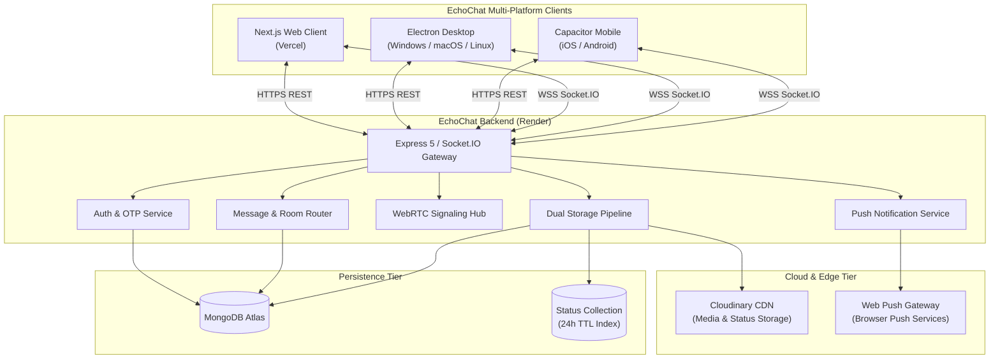

# Product Requirements Document (PRD): EchoChat

**Document Version:** 2.0.0  
**Status:** COMPLETE / PRODUCTION  
**Project Name:** EchoChat  
**Live Frontend:** [https://client-mu-taupe.vercel.app](https://client-mu-taupe.vercel.app)  
**Live Backend API:** [https://echochat-1-2ira.onrender.com](https://echochat-1-2ira.onrender.com)  
**Repository:** [https://github.com/Soumyaroy428/EchoChat](https://github.com/Soumyaroy428/EchoChat)  

---

## 1. Executive Summary & Vision

**EchoChat** is an enterprise-grade, real-time communication platform engineered to deliver feature parity with premier consumer messaging services (e.g., WhatsApp, Signal, Telegram). Built with high performance, resilience, and privacy at its core, EchoChat enables real-time 1-on-1 and group messaging, WebRTC peer-to-peer voice and video calling, 24-hour self-destructing status stories, rich multimedia transmission, Web Push offline notifications, client-side End-to-End Encryption (E2EE), and cross-platform native execution across Web, Desktop (Electron), and Mobile (Capacitor for iOS/Android).

---

## 2. Technical Stack & Infrastructure Architecture

### 2.1. Client-Side Architecture
- **Framework:** Next.js 15 (React 19, App Router)
- **Language:** TypeScript 5.x
- **Styling & UI:** Tailwind CSS 4, Radix UI Primitives, Lucide React Icons, Sonner Toasts
- **Real-Time Client:** Socket.IO Client (`socket.io-client` v4.8)
- **Calling Engine:** WebRTC via Simple-Peer (`simple-peer` v9.11)
- **Cryptography Engine:** Native Web Cryptography API (`window.crypto.subtle`) for zero-knowledge ECDH P-256 + AES-GCM 256
- **Offline / Push:** Service Worker API (`/sw.js`) with Web Push & VAPID protocol
- **Desktop Wrapper:** Electron v33+ (`client/electron/main.js`, `preload.js`)
- **Mobile Wrapper:** Capacitor v7+ (`client/capacitor.config.ts`)

### 2.2. Server-Side Architecture
- **Runtime & Framework:** Node.js 20+, Express.js 5.x, TypeScript
- **Real-Time Gateway:** Socket.IO Server (`socket.io` v4.8) with authenticated handshake & room routing
- **Database:** MongoDB Atlas (managed via Mongoose ODM v9 and Prisma v7)
- **Authentication:** JWT (JSON Web Tokens) with 7-day expiry and bcrypt password hashing
- **OTP Verification:** APITxT SMS Gateway (https://apitxt.com/api/sendOTP) with Twilio fallback & in-memory/DB OTP lifecycle
- **Push Engine:** `web-push` library with VAPID key pair exchange
- **Media Storage Pipeline:** Dual-tier architecture using Cloudinary CDN (`cloudinary` v2.10) with automatic fallback to authenticated local volume storage (`uploads/`)
- **Security & Rate Limiting:** Helmet HTTP headers, CORS whitelisting, Express Rate Limiters partitioned per critical route

---

## 3. High-Level System Architecture



---

## 4. Completed Feature Roadmap (All 5 Checkpoints)

EchoChat's feature set has been developed, hardened, and verified across 5 strategic checkpoints:

### Checkpoint 1: Core Messaging Parity & Presence (COMPLETED)
*Delivered standard real-time 1-on-1 messaging capabilities with zero message drop.*
- [x] **Socket Handshake Authentication:** Strict JWT validation on initial connection with `user:{userId}` private rooms.
- [x] **Real-Time 1-on-1 Messaging:** Instant message delivery with sub-50ms latency.
- [x] **Persistent Chat History:** MongoDB database persistence for cross-session integrity.
- [x] **Offline Message Recovery:** Unread messages stored and delivered upon recipient reconnection.
- [x] **Online Presence & Last Seen:** Dynamic `user_status` broadcasts tracking active sockets and timestamps.
- [x] **Typing Indicators:** Bidirectional `typing` and `stop_typing` events with automatic client-side timeouts.
- [x] **Delivery & Read Receipts:** Three-tier message receipt state:
  - Sent: Single tick (`✓`)
  - Delivered: Double grey tick (`✓✓`)
  - Read: Double blue tick (`✓✓`)
- [x] **Message Interactions:**
  - Emoji reactions with live socket sync (`add_reaction`, `remove_reaction`).
  - Threaded replies and quote previews (`replyTo`).
  - Dual message deletion: "Delete for me" (local hidden state) and "Delete for everyone" (`message_deleted` socket event).
- [x] **Search within Chat:** Real-time keyword filter across loaded message history.

### Checkpoint 2: Group Dynamics & Push Notifications (COMPLETED)
*Expanded messaging to multi-party conversations and re-engagement loops.*
- [x] **Group Creation & Management:** Create groups with custom name, description, group avatar, and initial members.
- [x] **Admin Privileges & Permissions:** Role-based access control with creator auto-admin, member promotion, and removal.
- [x] **Group Real-Time Messaging:** Socket.IO multi-room broadcasting (`join_group`, `send_message` with `groupId`).
- [x] **Web Push Notification Engine:**
  - VAPID key generation and distribution (`/api/notifications/vapid-key`).
  - Service worker background push listener (`sw.js`).
  - Direct deep-linking: Notification clicks open the exact conversation via `/?groupId=...` or `/?contactId=...`.
  - Multi-account isolation: Automatic push subscription unbinding on logout and rebinding on account change to prevent cross-account push contamination.

### Checkpoint 3: Rich Media & WebRTC Audio/Video Calling (COMPLETED)
*Integrated peer-to-peer audio/video calling and multimodal data transfer.*
- [x] **WebRTC 1-on-1 Voice & Video Calling:**
  - Full peer-to-peer WebRTC connection negotiation via Simple-Peer.
  - Concurrency-safe `callId` signaling state machine:
    - `call_user`: Caller initiates call with SDP offer.
    - `call_incoming`: Callee receives incoming call with caller details.
    - `answer_call`: Callee accepts with SDP answer.
    - `call_accepted`: Media stream established.
    - `reject_call`: Callee rejects or reports busy.
    - `end_call`: Participant terminates session.
  - Busy-line detection with graceful caller notification.
- [x] **Interactive Call Controls:**
  - Mic mute/unmute.
  - Camera enable/disable.
  - Screen sharing stream swap.
  - Picture-in-picture and fullscreen overlay modal (`CallModal.tsx`).
- [x] **Voice Notes:** In-browser audio recording via MediaRecorder API, audio duration calculation, and waveform playback UI.
- [x] **Document Sharing:** Transfer and view documents (PDF, Excel, Word, ZIP, images) with file size formatting and secure download links.
- [x] **Location Sharing:** HTML5 Geolocation capture with map visualizer and external Google Maps navigation links.

### Checkpoint 4: 24-Hour Disappearing Status (Stories) & Cloud CDN (COMPLETED)
*Added ephemeral social status updates and enterprise cloud storage.*
- [x] **WhatsApp-Style Status Updates:**
  - Ephemeral updates displayed in a dedicated Status tab.
  - Text statuses with custom vibrant background colors and typography.
  - Image and video statuses with media captions.
- [x] **Automated 24h Expiry via MongoDB TTL:**
  - Status documents created with `expiresAt = Date.now() + 24 hours`.
  - Native MongoDB TTL Index (`{ expires: 0 }` on `expiresAt`) guarantees zero-maintenance automatic pruning.
- [x] **Full-Featured Story Viewer Modal:**
  - Progress bar segments indicating duration per status slide.
  - Tap/click to advance or return to previous story.
  - Press-and-hold to pause story playback.
  - Viewer tracking with timestamps (`POST /api/status/:id/view`).
- [x] **Dual-Tier Cloud Storage Pipeline:**
  - Cloudinary CDN integration for fast global media distribution.
  - Automatic fallback to authenticated local volume storage if Cloudinary credentials are not configured.

### Checkpoint 5: Ultimate Security & Native Platform Packaging (COMPLETED)
*Implemented end-to-end encryption and wrapped client for native OS distribution.*
- [x] **Zero-Knowledge End-to-End Encryption (E2EE):**
  - Cryptographic standard: ECDH (Elliptic Curve Diffie-Hellman) over curve P-256 with AES-GCM 256-bit symmetric encryption.
  - Native Web Cryptography API (`window.crypto.subtle`) for client-side key generation and encryption.
  - Private keys never leave the user's browser (stored strictly in `localStorage`).
  - Unique 96-bit random Initialization Vector (IV) generated per message.
  - Fallback mechanism ensuring non-E2EE messages continue to transmit cleanly.
- [x] **Capacitor Mobile App (iOS & Android):**
  - Configured via `client/capacitor.config.ts`.
  - App ID: `com.echochat.app`.
  - Configured for native push notifications, splash screen, and offline shell.
- [x] **Electron Desktop App (Windows, macOS, Linux):**
  - Configured via `client/electron/main.js` and `preload.js`.
  - Frameless modern window design with native menu bar suppression.
  - Safe external link handling delegating to system browser.

---

## 5. Data Models & Database Schemas

### 5.1. User Model (`User.ts`)
```typescript
{
  name: { type: String, required: true },
  mobile: { type: String, required: true, unique: true },
  password: { type: String, required: true },
  avatar: { type: String, default: "" },
  about: { type: String, default: "Hey there! I am using EchoChat." },
  isOnline: { type: Boolean, default: false },
  lastSeen: { type: Date, default: Date.now },
  e2eePublicKey: { type: String, default: "" },
  pushSubscriptions: [{
    endpoint: String,
    keys: { p256dh: String, auth: String }
  }]
}
```

### 5.2. Contact Model (`newContact.ts`)
```typescript
{
  userId: { type: Schema.Types.ObjectId, ref: "User", required: true },
  name: { type: String, required: true },
  mobile: { type: String, required: true }
}
```

### 5.3. Message History Model (`messageHistory.ts`)
```typescript
{
  senderId: { type: String, required: true, index: true },
  receiverId: { type: String, index: true },
  groupId: { type: Schema.Types.ObjectId, ref: "Group", index: true },
  content: { type: String, default: "" },
  mediaUrl: { type: String, default: "" },
  status: { type: String, enum: ["sent", "delivered", "read"], default: "sent" },
  timestamp: { type: Date, default: Date.now, index: true },
  reactions: [{
    userId: String,
    emoji: String
  }],
  replyTo: {
    messageId: String,
    content: String,
    senderName: String
  },
  deletedFor: [String],
  isDeletedForEveryone: { type: Boolean, default: false }
}
```

### 5.4. Group Model (`Group.ts`)
```typescript
{
  name: { type: String, required: true },
  description: { type: String, default: "" },
  icon: { type: String, default: "" },
  creator: { type: Schema.Types.ObjectId, ref: "User", required: true },
  admins: [{ type: Schema.Types.ObjectId, ref: "User" }],
  members: [{ type: Schema.Types.ObjectId, ref: "User" }]
}
```

### 5.5. Status Model (`Status.ts`)
```typescript
{
  user: { type: Schema.Types.ObjectId, ref: "User", required: true, index: true },
  mediaUrl: { type: String, default: "" },
  mediaType: { type: String, enum: ["text", "image", "video"], default: "text" },
  text: { type: String, maxlength: 500 },
  backgroundColor: { type: String, default: "#0d6b50" },
  font: { type: String, default: "sans-serif" },
  viewers: [{
    user: { type: Schema.Types.ObjectId, ref: "User" },
    viewedAt: { type: Date, default: Date.now }
  }],
  createdAt: { type: Date, default: Date.now },
  expiresAt: { type: Date, required: true, index: { expires: 0 } } // MongoDB TTL Index
}
```

---

## 6. API Endpoint Catalog

| Method | Endpoint | Description | Auth Required |
| :--- | :--- | :--- | :--- |
| `POST` | `/api/auth/register` | Register new user with mobile, name, password | No |
| `POST` | `/api/auth/login` | Authenticate with credentials, returns JWT | No |
| `POST` | `/api/auth/sendOtp` | Dispatch verification OTP via Twilio SMS | No (Rate-Limited) |
| `POST` | `/api/auth/verifyOtp` | Validate OTP code | No (Rate-Limited) |
| `GET` | `/api/auth/me` | Fetch authenticated user profile & public key | Yes |
| `PUT` | `/api/auth/profile` | Update user name, about, avatar, or E2EE key | Yes |
| `GET` | `/api/contacts` | Retrieve contacts with online & lastSeen state | Yes |
| `POST` | `/api/contacts` | Add new contact by mobile number | Yes |
| `DELETE` | `/api/contacts/:id` | Remove contact | Yes |
| `GET` | `/api/groups` | Fetch all groups the user belongs to | Yes |
| `POST` | `/api/groups` | Create new group | Yes |
| `GET` | `/api/groups/:id` | Fetch group details and member roster | Yes |
| `POST` | `/api/groups/:id/members` | Add members to group (Admin only) | Yes |
| `DELETE` | `/api/groups/:id/members/:id`| Remove member from group (Admin only) | Yes |
| `PUT` | `/api/groups/:id/admins` | Promote member to group admin | Yes |
| `GET` | `/api/messages` | Fetch conversation history (direct or group) | Yes |
| `POST` | `/api/messages` | Send message (REST fallback) | Yes |
| `DELETE` | `/api/messages/:id` | Delete message (for me or everyone) | Yes |
| `POST` | `/api/messages/:id/reaction` | Add emoji reaction to message | Yes |
| `DELETE` | `/api/messages/:id/reaction` | Remove emoji reaction from message | Yes |
| `POST` | `/api/media/upload` | Upload multimedia asset (Cloudinary / disk) | Yes |
| `GET` | `/uploads/chat_media/:file` | Authenticated file download/stream | Yes |
| `GET` | `/api/status` | Fetch active status updates from contacts | Yes |
| `POST` | `/api/status` | Publish new 24h status (text or media) | Yes |
| `POST` | `/api/status/:id/view` | Mark status as viewed by user | Yes |
| `DELETE` | `/api/status/:id` | Delete own status prior to 24h expiry | Yes |
| `GET` | `/api/notifications/vapid-key`| Fetch backend VAPID public key | Yes |
| `POST` | `/api/notifications/subscribe` | Register browser Web Push subscription | Yes |
| `POST` | `/api/notifications/unsubscribe`| Unregister browser Web Push subscription | Yes |

---

## 7. Socket.IO Real-Time Event Matrix

| Event Name | Direction | Payload | Description |
| :--- | :--- | :--- | :--- |
| `user_status` | Server → Client | `{ userId, isOnline, lastSeen }` | Broadcasts user online/offline status |
| `typing` | Client → Server | `{ receiverId }` | Emits typing state to recipient |
| `stop_typing` | Client → Server | `{ receiverId }` | Emits typing cessation |
| `user_typing` | Server → Client | `{ senderId }` | Notifies recipient that sender is typing |
| `user_stop_typing` | Server → Client | `{ senderId }` | Notifies recipient that sender stopped typing |
| `send_message` | Client → Server | `{ receiverId?, groupId?, content?, mediaUrl? }` | Emits message with acknowledgment |
| `message_received` | Server → Client | `Message` object | Delivers message to active recipients |
| `mark_read` | Client → Server | `{ messageIds, senderId }` | Callee informs sender messages were read |
| `messages_read` | Server → Client | `{ messageIds, readerId }` | Updates blue tick status on sender UI |
| `messages_delivered` | Server → Client | `{ messageIds, receiverId }` | Updates double tick status on sender UI |
| `message_deleted` | Server ⇄ Client | `{ messageId }` | Broadcasts message deletion for everyone |
| `call_user` | Client → Server | `{ userToCall, signalData, name, isVideo, callId? }` | Initiates WebRTC call with session ID |
| `call_incoming` | Server → Client | `{ callId, signal, from, name, isVideo }` | Notifies callee of incoming call |
| `answer_call` | Client → Server | `{ callId, signal, to }` | Callee sends SDP answer |
| `call_accepted` | Server → Client | `{ signal, callId }` | Caller receives answer, media connected |
| `reject_call` | Client → Server | `{ callId, to, reason }` | Callee rejects call or sends busy state |
| `call_rejected` | Server → Client | `{ callId, reason }` | Caller notified of rejection/busy |
| `end_call` | Client → Server | `{ callId, to }` | Participant terminates ongoing call |
| `call_ended` | Server → Client | `{ callId }` | Other participant notified to teardown peer |

---

## 8. Security & Privacy Architecture

1. **Authentication & Token Governance:**
   - JWTs signed using secure cryptographic secrets with 7-day expiration.
   - Socket handshake strictly rejects connections lacking valid tokens.
2. **Access-Controlled Media Serving:**
   - The `/uploads/chat_media/:filename` endpoint strictly validates JWT identity and checks membership in the direct chat or group before streaming media bytes.
3. **End-to-End Encryption (E2EE):**
   - Zero-knowledge encryption implemented using the Web Cryptography API (`ECDH P-256 + AES-GCM 256`).
   - Private keys are stored exclusively in client `localStorage`.
   - The server and database store and relay only encrypted ciphertext.
4. **Rate Limiting & Abuse Prevention:**
   - Independent Express rate limiters applied to authentication and OTP dispatch endpoints (`/sendOtp`, `/verifyOtp`).

---

## 9. Deployment & Production Verification

- **Frontend Deployment:** Vercel Edge Network  
  URL: `https://client-mu-taupe.vercel.app`
- **Backend Deployment:** Render Web Service  
  URL: `https://echochat-1-2ira.onrender.com`
- **Database:** MongoDB Atlas (M0/Dedicated Tier)
- **Status:** All 5 checkpoints implemented, audited, deployed, and operational.
