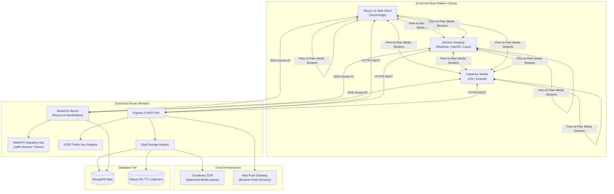

# EchoChat 💬

<div align="center">


[](https://nextjs.org/)
[](https://react.dev/)
[](https://www.typescriptlang.org/)
[](https://nodejs.org/)
[](https://expressjs.com/)
[](https://socket.io/)
[](https://webrtc.org/)
[](https://www.mongodb.com/)
[](https://cloudinary.com/)
[](https://vercel.com/)
[](https://render.com/)

**A modern, production-grade, full-stack real-time messaging and calling application inspired by WhatsApp and Signal.**

[🌐 Live Web Client](https://client-mu-taupe.vercel.app) • [🚀 Live Backend API](https://echochat-1-2ira.onrender.com) • [📋 Product Requirements Document](./PRD.md)

</div>

---

## 🌟 Key Highlights

- **⚡ Real-Time Messaging:** Sub-50ms message delivery via WebSocket (Socket.IO) with persistent MongoDB storage.
- **📞 WebRTC 1-on-1 Calling:** Peer-to-peer Voice & Video calling with `callId` session tracking, screen share, and mute controls.
- **🔒 End-to-End Encryption (E2EE):** Zero-knowledge client-side encryption using the native Web Cryptography API (`ECDH P-256` + `AES-GCM 256`).
- **⏳ 24-Hour Disappearing Stories:** Ephemeral text, photo, and video status updates with automatic MongoDB TTL-driven pruning.
- **👥 Dynamic Groups:** Multi-user group conversations with administrator controls (promote members, remove participants).
- **🔔 Web Push Notifications:** VAPID-authenticated background and foreground notifications with deep link navigation directly into conversations.
- **🎙️ Multimodal Sharing:** Voice notes recording with live waveforms, documents & PDFs with secure download, and GPS location sharing with map previews.
- **🎨 Modern Dark Neon Theme:** WhatsApp doodle wallpaper, glassmorphism UI, responsive desktop, tablet, and mobile layouts.
- **📱 Native Cross-Platform:** Ready-to-build wrappers for **Electron** (Desktop) and **Capacitor** (iOS & Android).

---

## 🏗️ Architecture & Data Flow



---

## 📦 Project Structure

```text
EchoChat/
├── client/                      # Next.js 15 App Router Frontend
│   ├── app/                     # Next.js pages & layout routes
│   │   ├── globals.css          # Neon WhatsApp styling & themes
│   │   ├── layout.tsx           # Root HTML layout with providers
│   │   └── page.tsx             # Main entrypoint
│   ├── components/              # Modular UI components
│   │   ├── auth/                # AuthPage & OtpModal
│   │   ├── chat/                # Messages, CallModal, AuthImage, Voice, Location
│   │   ├── contactBar/          # Contacts list & AddContact modal
│   │   ├── landing/             # Welcome & landing screens
│   │   ├── main/                # Primary chat view orchestrator
│   │   ├── sidebar/             # Navigation sidebar, Status, Groups, Settings
│   │   └── ui/                  # Radix UI primitives & design tokens
│   ├── electron/                # Desktop application wrapper
│   │   ├── main.js              # Electron window configuration
│   │   └── preload.js           # Secure IPC bridge
│   ├── lib/                     # Utilities & core engines
│   │   ├── e2ee.ts              # Web Cryptography API (ECDH P-256 + AES-GCM)
│   │   ├── push.ts              # Web Push subscription lifecycle
│   │   ├── socket.ts            # Socket.IO client instance & listeners
│   │   └── utils.ts             # Styling helpers
│   ├── public/                  # Static assets & wallpapers
│   │   ├── sw.js                # Push Notification Service Worker
│   │   └── images/              # Custom chat wallpaper & doodles
│   ├── capacitor.config.ts      # Native iOS/Android configuration
│   └── package.json             # Frontend dependencies & scripts
│
├── server/                      # Express 5 & Socket.IO Backend
│   ├── src/
│   │   ├── app.ts               # Express configuration & Socket.IO handlers
│   │   ├── server.ts            # HTTP server bootstrap & DB connection
│   │   ├── config/              # MongoDB connection configuration
│   │   ├── controllers/         # REST business logic controllers
│   │   │   ├── authController.ts
│   │   │   ├── contactController.ts
│   │   │   ├── groupController.ts
│   │   │   ├── mediaController.ts
│   │   │   ├── messageHistoryController.ts
│   │   │   ├── notificationController.ts
│   │   │   └── statusController.ts
│   │   ├── middleware/          # Auth guards, upload handlers, rate limiters
│   │   ├── models/              # Mongoose schemas (User, Group, Status, Message)
│   │   ├── routes/              # Express API route modules
│   │   ├── services/            # Cloudinary & Local Storage services
│   │   └── utils/               # Web Push dispatcher
│   ├── prisma/                  # Optional Prisma ORM schema
│   ├── uploads/                 # Local media fallback storage
│   └── package.json             # Backend dependencies & scripts
│
├── PRD.md                       # Comprehensive Product Requirements Document
├── DEPLOYMENT.md                # Cloud production deployment instructions
└── README.md                    # Project documentation
```

---

## 🚀 Quick Start Guide

### Prerequisites
- **Node.js:** v20.0.0 or higher
- **npm:** v10.0.0 or higher
- **MongoDB:** Local instance or [MongoDB Atlas](https://www.mongodb.com/cloud/atlas) URI

### 1. Clone Repository & Install Dependencies

```bash
git clone https://github.com/Soumyaroy428/EchoChat.git
cd EchoChat

# Install backend dependencies
cd server
npm install

# Install frontend dependencies
cd ../client
npm install
```

---

### 2. Configure Environment Variables

#### Backend Configuration (`server/.env`)
Create `server/.env`:

```env
PORT=5000
MONGODB_URI=mongodb+srv://<username>:<password>@cluster0.mongodb.net/echochat?retryWrites=true&w=majority
JWT_SECRET=your-super-strong-jwt-secret-key-32-chars-min

# APITxT (SMS OTP) - https://apitxt.com/apikey (Primary)
APITXT_API_KEY=your-apitxt-api-key

# Twilio (SMS OTP) - Optional fallback
TWILIO_ACCOUNT_SID=
TWILIO_AUTH_TOKEN=
TWILIO_PHONE_NUMBER=

# Cloudinary CDN - Optional (defaults to secure local uploads/ storage)
CLOUDINARY_CLOUD_NAME=
CLOUDINARY_API_KEY=
CLOUDINARY_API_SECRET=

# Web Push VAPID Keys
VAPID_PUBLIC_KEY=
VAPID_PRIVATE_KEY=
VAPID_SUBJECT=mailto:admin@echochat.app
```

#### Frontend Configuration (`client/.env.local`)
Create `client/.env.local`:

```env
NEXT_PUBLIC_SOCKET_URL=http://localhost:5000
NEXT_PUBLIC_API_URL=http://localhost:5000

# APITxT (SMS OTP) - Can be placed in Vercel environment variables
APITXT_API_KEY=your-apitxt-api-key
```

---

### 3. Run Locally

Open two separate terminals:

**Terminal 1 (Backend):**
```bash
cd server
npm run dev
```
*Backend runs on `http://localhost:5000`.*

**Terminal 2 (Frontend):**
```bash
cd client
npm run dev
```
*Frontend runs on `http://localhost:3000`.*

Open [http://localhost:3000](http://localhost:3000) in your browser.

---

## 🖥️ Native Desktop & Mobile Packaging

EchoChat includes configured wrappers for desktop and mobile devices.

### Desktop App (Electron)
Run EchoChat as a native desktop application with frameless styling and system tray integration:

```bash
cd client
npm run electron:start
```

### Mobile App (Capacitor for iOS & Android)
Sync and open native mobile projects:

```bash
cd client

# Build Next.js application
npm run build

# Sync assets to native Capacitor platforms
npm run cap:sync

# Open Android Studio project
npx cap open android

# Open Xcode project (macOS only)
npx cap open ios
```

---

## 📡 API Endpoint Reference

| Method | Route | Description | Auth |
| :--- | :--- | :--- | :--- |
| `POST` | `/api/auth/register` | Register new user with phone & password | Public |
| `POST` | `/api/auth/login` | Login with credentials and receive JWT | Public |
| `POST` | `/api/auth/sendOtp` | Dispatch verification OTP via Twilio | Rate-Limited |
| `POST` | `/api/auth/verifyOtp` | Verify OTP code | Rate-Limited |
| `GET` | `/api/auth/me` | Fetch current user profile & public key | Bearer JWT |
| `PUT` | `/api/auth/profile` | Update profile details (avatar, name, bio) | Bearer JWT |
| `GET` | `/api/contacts` | Get contact list with live presence info | Bearer JWT |
| `POST` | `/api/contacts` | Save new contact by phone number | Bearer JWT |
| `GET` | `/api/groups` | List user's active group memberships | Bearer JWT |
| `POST` | `/api/groups` | Create group with members and avatar | Bearer JWT |
| `POST` | `/api/groups/:id/members` | Add participants to existing group | Group Admin |
| `DELETE`| `/api/groups/:id/members/:mId`| Remove participant from group | Group Admin |
| `GET` | `/api/messages` | Fetch conversation history (query: `contactId` or `groupId`) | Bearer JWT |
| `POST` | `/api/messages` | Send message (REST fallback) | Bearer JWT |
| `DELETE`| `/api/messages/:id` | Delete message (for me or everyone) | Bearer JWT |
| `POST` | `/api/messages/:id/reaction`| Attach emoji reaction to message | Bearer JWT |
| `POST` | `/api/media/upload` | Upload audio, document, or image file | Bearer JWT |
| `GET` | `/uploads/chat_media/:file` | Authenticated file download stream | Bearer JWT |
| `GET` | `/api/status` | List contacts' active 24h stories | Bearer JWT |
| `POST` | `/api/status` | Create new text, image, or video story | Bearer JWT |
| `POST` | `/api/status/:id/view` | Mark story as viewed by user | Bearer JWT |
| `GET` | `/api/notifications/vapid-key`| Fetch VAPID public key for push | Bearer JWT |
| `POST` | `/api/notifications/subscribe`| Save push subscription | Bearer JWT |

---

## ⚡ Socket.IO Event Reference

### Real-Time Messaging & Status
- **`user_status`**: Broadcasts `{ userId, isOnline, lastSeen }` to all clients.
- **`typing` / `stop_typing`**: Client emits typing indicator to recipient.
- **`send_message`**: Transmits message payload `{ receiverId, groupId, content, mediaUrl }` with acknowledgment.
- **`message_received`**: Delivers real-time message to recipient or group room.
- **`mark_read`**: Updates message status to `read` (blue ticks).
- **`message_deleted`**: Broadcasts message deletion across participants.

### WebRTC Calling Protocol
- **`call_user`**: Initiates 1-on-1 voice or video call with SDP offer and `callId`.
- **`call_incoming`**: Notifies callee of an incoming call session.
- **`answer_call`**: Callee transmits SDP answer for session establishment.
- **`call_accepted`**: Caller connects peer-to-peer stream.
- **`reject_call`**: Callee rejects or signals busy.
- **`end_call`**: Gracefully terminates peer session and releases camera/mic.

---

## 🔐 End-to-End Encryption (E2EE) Details

EchoChat implements client-side zero-knowledge End-to-End Encryption:
1. **Key Generation:** When a user logs in, an **ECDH P-256** asymmetric keypair is generated via `window.crypto.subtle`.
2. **Key Storage:** The user's private key is stored exclusively in local browser storage (`localStorage`) and is never sent to the network.
3. **Public Key Exchange:** Public keys in standard JWK format are registered via `/api/auth/profile` and fetched during conversation initiation.
4. **Secret Derivation:** An **AES-GCM 256-bit** symmetric session key is derived on-the-fly using Elliptic Curve Diffie-Hellman.
5. **Ciphertext Delivery:** Messages are encrypted with a random 96-bit Initialization Vector (IV). The backend server and database only handle the opaque ciphertext.

---

## 🚢 Deployment

### Production Environments
- **Frontend:** Hosted on **Vercel**  
  [https://client-mu-taupe.vercel.app](https://client-mu-taupe.vercel.app)
- **Backend:** Hosted on **Render** (Node.js Web Service)  
  [https://echochat-1-2ira.onrender.com](https://echochat-1-2ira.onrender.com)
- **Database:** **MongoDB Atlas**

For full cloud provisioning and deployment walkthroughs, see [DEPLOYMENT.md](./DEPLOYMENT.md).

---

## 📄 License

This project is open-source under the [MIT License](LICENSE). Built for learning and enterprise messaging reference architecture.
